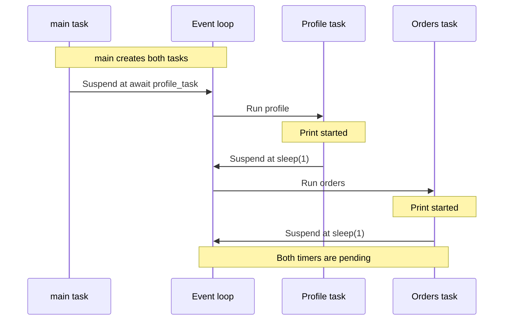

Loading a profile takes one second. Loading its orders takes another. Both operations are async,
and both calls use `await`, yet together they still take about two seconds:

```python
import asyncio
from time import perf_counter


async def load(name: str) -> str:
    print(f"{name}: started")
    await asyncio.sleep(1)
    print(f"{name}: finished")
    return name


async def main() -> None:
    started = perf_counter()
    await load("profile")
    await load("orders")
    print(f"Elapsed: {perf_counter() - started:.1f}s")


asyncio.run(main())
```

Here, `asyncio.sleep()` stands in for waiting on asynchronous I/O. The output shows the problem:

```text
profile: started
profile: finished
orders: started
orders: finished
Elapsed: 2.0s
```

`main()` waits for the profile load to finish before it even calls `load("orders")`.
These two operations execute sequentially, just as two ordinary synchronous calls would.

The difference is what happens during the wait: an asynchronous wait can let the event loop run
other scheduled work. But it cannot start an operation that our code has not reached yet.
**Using `await` on two async calls does not automatically make them concurrent.**

That ordering is useful when the second operation needs the first result. Our two loads are
independent, so we can schedule both before waiting for either to finish.

## Schedule Both Before Waiting

Replace `main()` with this version, keeping `load()` and `asyncio.run(main())`:

```python
async def main() -> None:
    started = perf_counter()
    profile_task = asyncio.create_task(load("profile"))
    orders_task = asyncio.create_task(load("orders"))

    await profile_task
    await orders_task
    print(f"Elapsed: {perf_counter() - started:.1f}s")
```

[`create_task()`][tasks] schedules each load as a separate task. Both tasks exist before
`main()` starts waiting for the profile result.

A typical run now prints:

```text
profile: started
orders: started
profile: finished
orders: finished
Elapsed: 1.0s
```

The profile load starts waiting, then the orders load starts waiting too. Their one-second waits
overlap, so both finish in about one second. Timings are approximate, and completion order can vary.

The two `await` statements still appear one after another. What changed is when the operations
were scheduled: orders can make progress while `main()` waits for profile.

Creating a task and immediately awaiting it before creating the next one preserves the original
sequential behavior:

```python
profile_task = asyncio.create_task(load("profile"))
await profile_task

orders_task = asyncio.create_task(load("orders"))
await orders_task
```

This still takes about two seconds. To overlap these loads, both must be scheduled before we wait
for either to finish.

For this example, a shorter way to schedule both and wait for their results is:

```python
profile, orders = await asyncio.gather(load("profile"), load("orders"))
```

[`gather()`][gather] schedules the coroutine arguments as tasks. On success, it returns their
results in argument order, regardless of which finishes first.

## What Gets Scheduled?

Calling `load("profile")` creates a coroutine object without running its body. A task manages
a coroutine's execution and tracks its result. The event loop runs ready tasks and monitors
timers and I/O.

`asyncio.run(main())` starts an event loop and runs `main()` as a task. From there, these two
expressions behave differently:

```python
await load("profile")
```

The current task enters `load()` and follows it through to completion. When `load()` suspends,
the current task suspends too. No separate task is created.

```python
profile_task = asyncio.create_task(load("profile"))
```

A separate task is created and scheduled. Under the default scheduling used in this example,
it starts when the current task gives control back to the loop.

This is why the first version runs sequentially: one task follows `main()` into the profile load,
back out, and then into the orders load. The concurrent version gives the loop two load tasks
that can progress independently. The [conceptual asyncio guide][concepts] explains this distinction
in more depth.

## Who Runs While a Task Waits?

Within one event-loop thread, only one task executes Python code at a time. Concurrency comes
from letting another task run while the current one is waiting.

The start of our concurrent example follows this sequence:



The loop can now handle other ready work or wait for a timer or I/O event. After about one second,
both loads become ready to resume. Each gets a turn to print its final message and return.
`main()` finishes after both results are available.

A timer becoming ready does not interrupt the task currently running. That task must give up
control before the loop can run something else.

This is [cooperative scheduling][development]. A task keeps control until it suspends or its
execution ends, whether by returning or by letting an exception escape.

## An Await Is a Possible Handoff

An `await` does not always suspend the current task. If the awaited operation can finish
immediately, execution can continue without giving another task a turn:

```python
async def cached_name() -> str:
    return "Ada"


async def main() -> None:
    name = await cached_name()
    print(name)
```

There is no suspension inside `cached_name()`. Awaiting it does not make the loop switch tasks.
By contrast, [`asyncio.sleep()`][sleep] always suspends the current task, even with a delay of zero.

This also explains why blocking code breaks the overlap. In the original `load()` function,
replace `await asyncio.sleep(1)` with `time.sleep(1)` after importing `time`.

Even with both tasks scheduled first, the total returns to about two seconds. Each blocking sleep
holds the loop's thread, preventing the other task from advancing during that second.
Putting blocking code inside `async def` does not change its behavior.

For blocking I/O without an async API, [`asyncio.to_thread()`][threads] can move the call to a
worker thread. Long CPU calculations also hold up the loop while they run on its thread;
creating more asyncio tasks does not make those calculations execute in parallel.

When two operations fail to overlap, check both sides: did you schedule them independently before
waiting, and does their work actually suspend so the loop can run something else?

[tasks]: https://docs.python.org/3.14/library/asyncio-task.html#asyncio.create_task
[gather]: https://docs.python.org/3.14/library/asyncio-task.html#asyncio.gather
[concepts]: https://docs.python.org/3.14/howto/a-conceptual-overview-of-asyncio.html
[development]: https://docs.python.org/3.14/library/asyncio-dev.html#concurrency-and-multithreading
[sleep]: https://docs.python.org/3.14/library/asyncio-task.html#asyncio.sleep
[threads]: https://docs.python.org/3.14/library/asyncio-task.html#asyncio.to_thread
